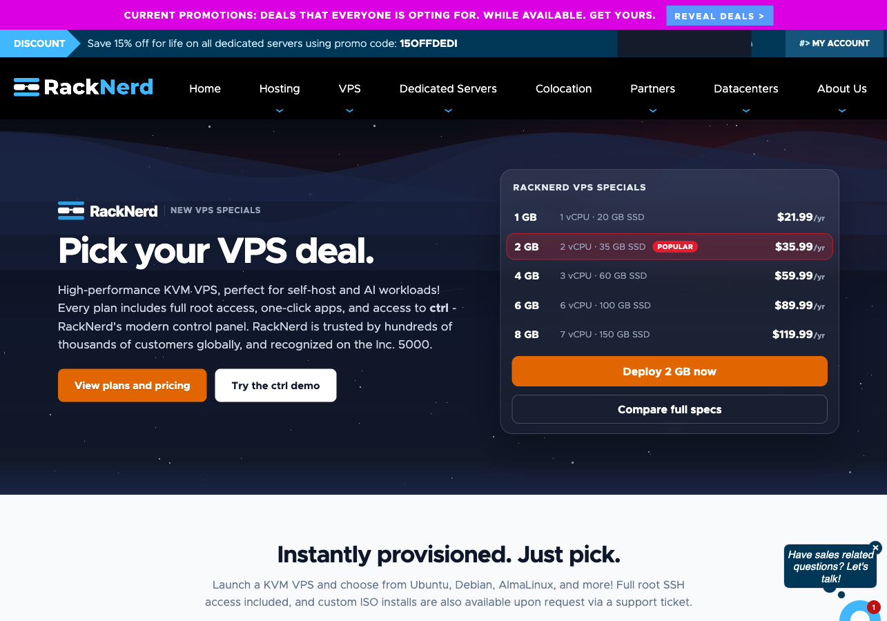
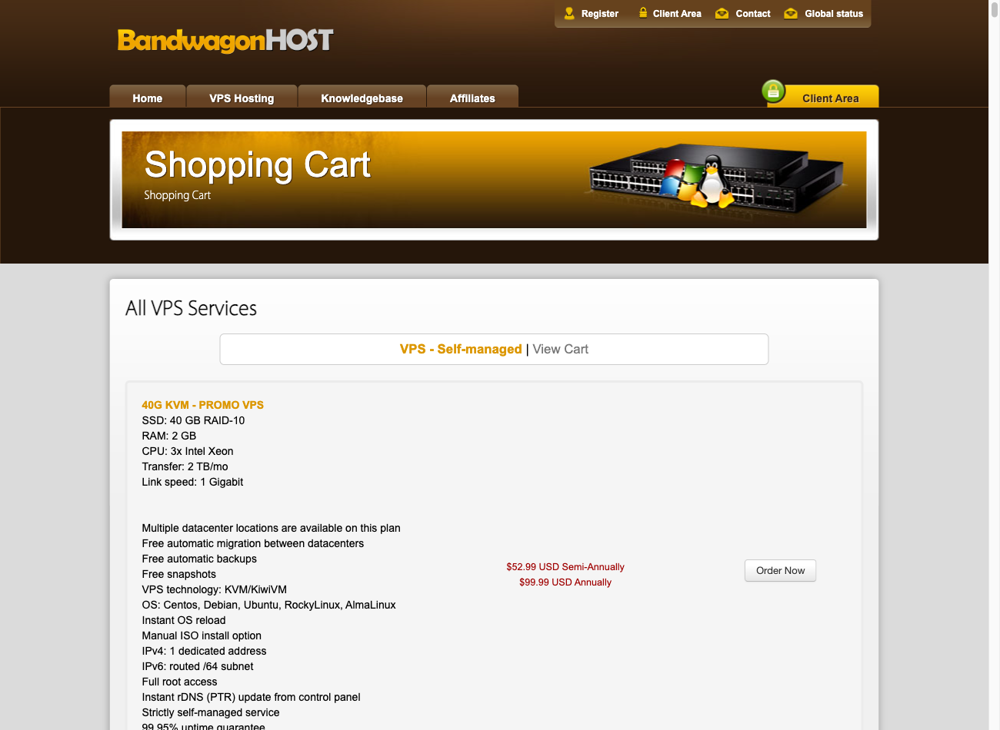
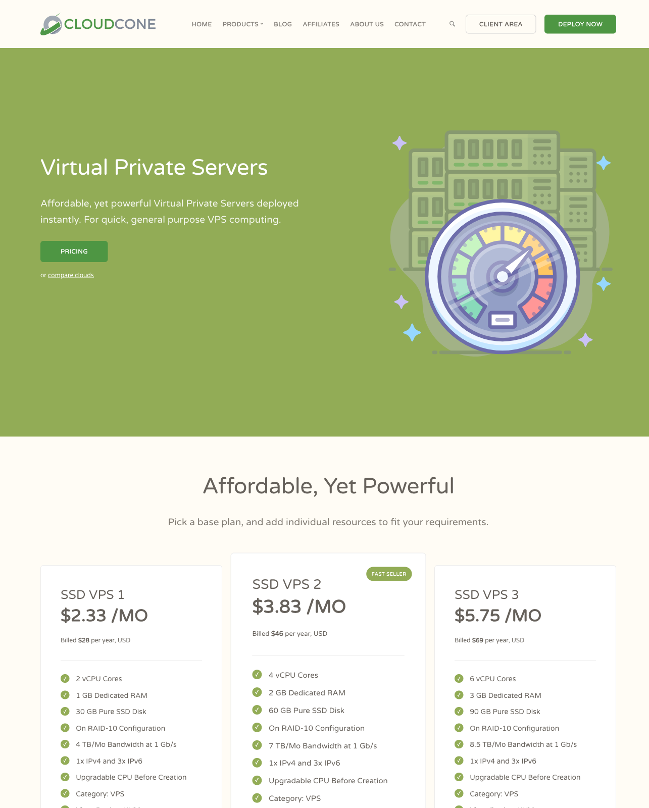
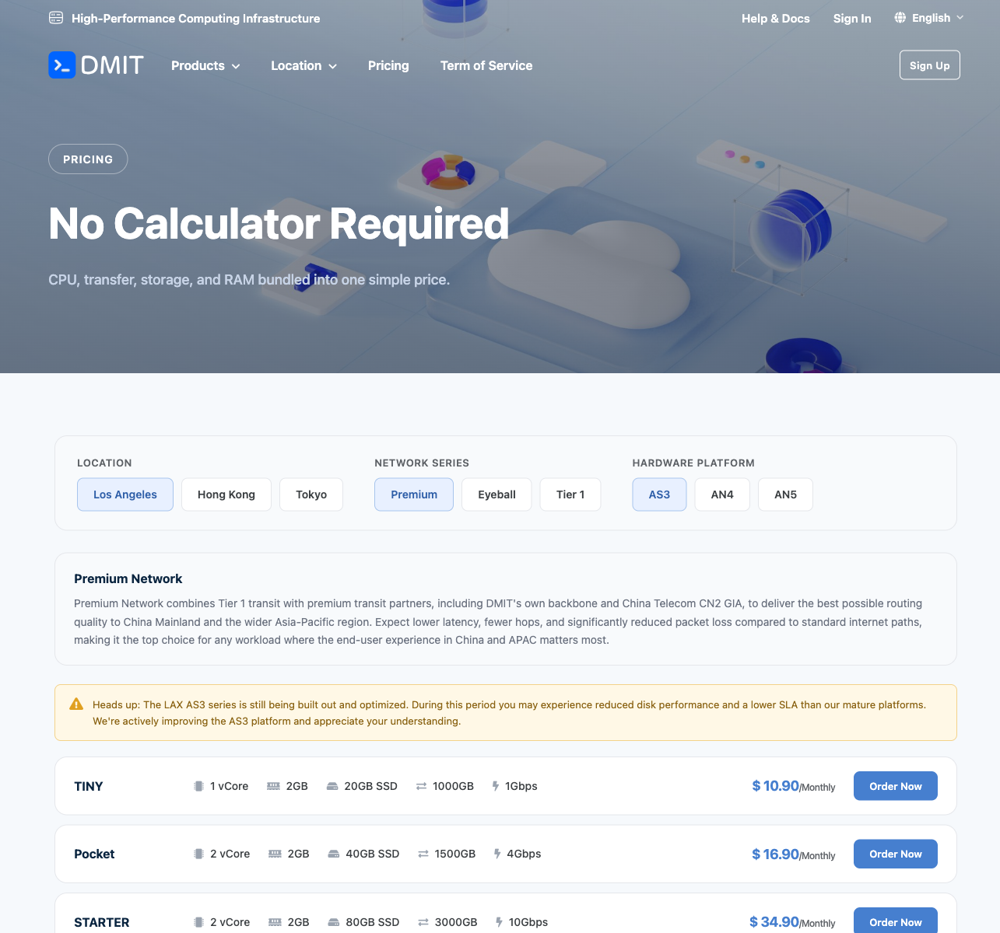
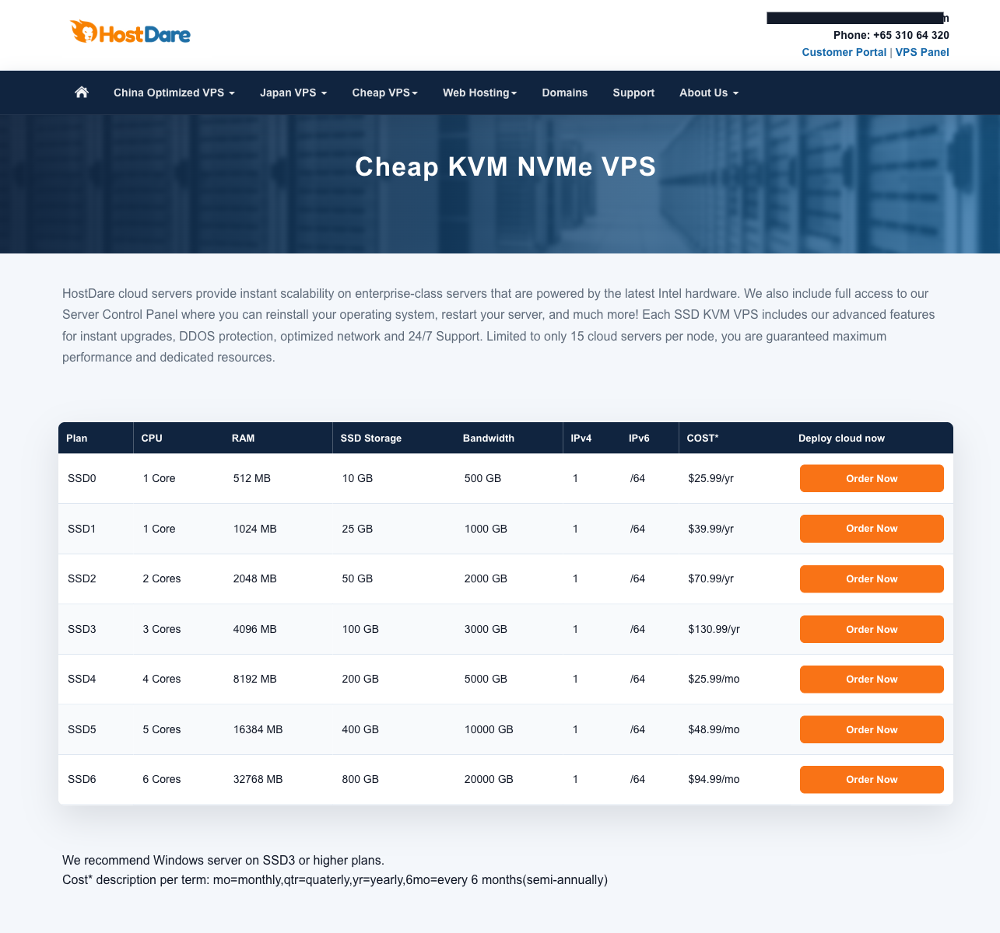
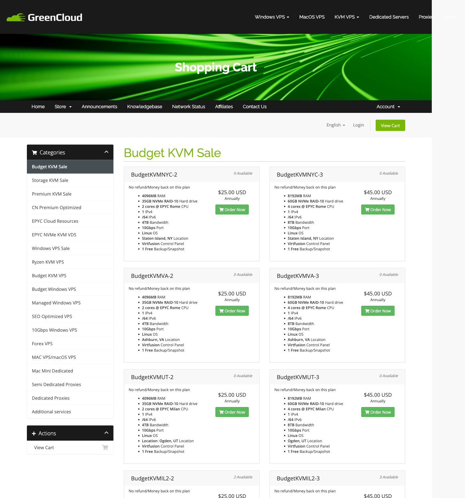
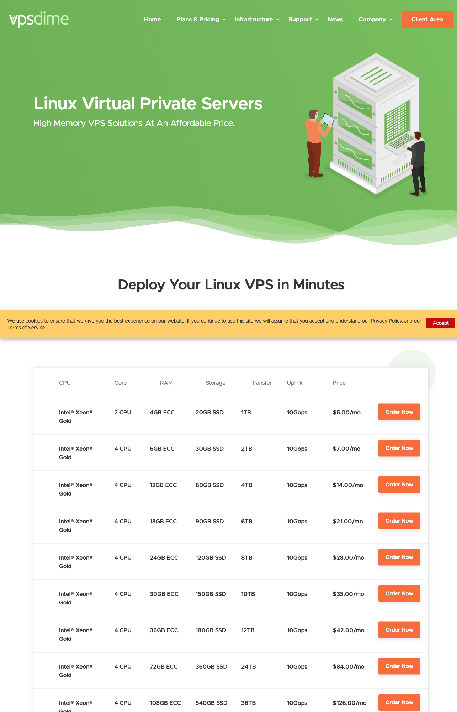
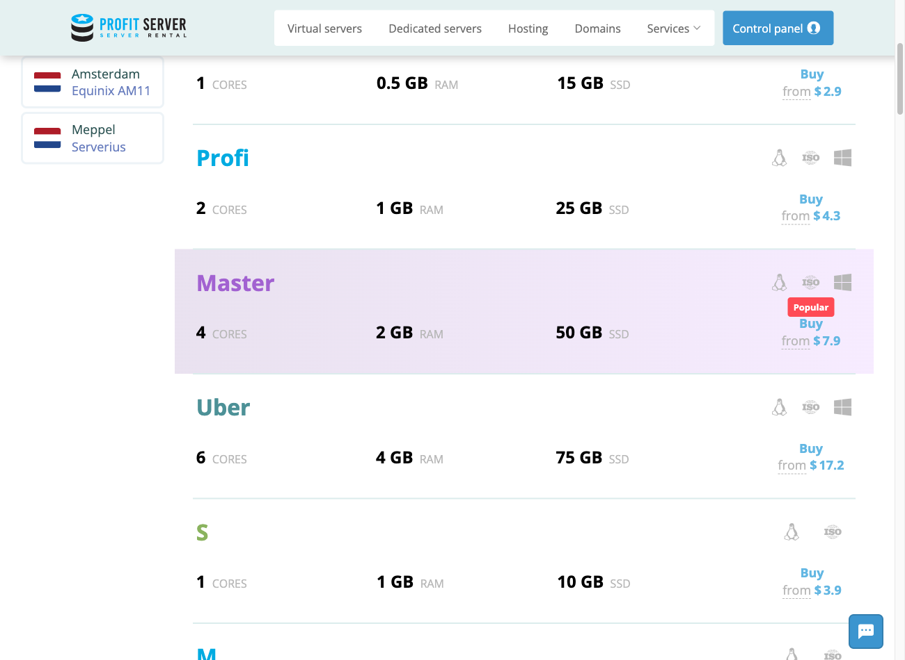

# 便宜 VPS / 年付 VPS 怎么选：中文开发者的 8 家候选清单

> **更新日期：2026-11-04（挂码）｜价格核验日期：2026-11-02**  
> 面向搜索：**VPS 推荐 / 便宜 VPS / 年付 VPS**  
> 当前状态：成品稿，待发布；本站尚未购买或实测这 8 家 VPS。
> 行动入口说明：本文 **RackNerd 的两处按钮挂的是本站自有推广链接**（由站点所有者提供并确认归本站所有），**其余 7 家的按钮仍是普通官网链接**——普通官网链接不等于有效推广入口；本文不使用别人的邀请码。

> **推广披露：****本文中标注为「本站推广链接」的只有 RackNerd 一处**——该链接由站点所有者提供并确认归本站所有；通过它注册或购买**可能**给我们带来佣金，**对读者价格没有影响**。⚠️ 本站**没有**登录 RackNerd 后台自行激活或核验该链接，其佣金比例、结算与提现条款一律以站方后台与合同为准，本文不作任何承诺。**其余 7 家仍为普通官网链接，本站不从中获得佣金。**挂码不影响价格快照、线路证据、缺点与对照结果。价格会随库存、地区、税费、周期和促销变化，最终以官网结账页为准。

低价 VPS 不该从“哪家参数最多”开始选。先回答一个更实际的问题：**你准备拿它做什么？**

## 先按场景选，不要先按品牌选

```text
只是试水 Linux / 跑小脚本
└─ RackNerd：1 GB 活动机约 $21.99/年，试错成本相对低

给中国大陆访客做小站
└─ HostDare：中国优化 / CN2 产品与普通 SSD 产品分开卖，先按线路选系列

要拆成多台小机 / 多地部署
└─ ProfitServer：宣传 $2.90/月起，多数地区公开页约 $3.90/月，便于按月拆预算

愿意多花钱，把中国方向线路放在配置之前
└─ DMIT：LAX T1 示例约 $69.21/年，CN2 / 亚太高端线价位更高
```

以上价格的**核验日期均为 2026-11-02**，只代表公开页面快照。

这四个推荐都有前提：

- **RackNerd** 的低年付适合练手，不代表它天然适合中国大陆访客。
- **HostDare** 有中国优化系列，不代表任何机房、任何套餐都走同一种线路。
- **ProfitServer** 的月价适合拆机器，但本站没有确认其中国方向为 CN2 或直连。
- **DMIT** 的卖点偏线路和区域产品，不代表本站已经测出它比其他家快——本文目前没有自购测速。

**首屏 CTA（本站推广链接）：**[通过本站推广链接查看 RackNerd 当前公开套餐](https://my.racknerd.com/aff.php?aff=21833)

如果你的需求不在这四类里，再看后面的 8 家横向表和逐家说明。

## 8 家先看一张表

| 商家 | 公开价位（核验日期 2026-11-02） | 计费/库存口径 | 更适合 | 不太适合 | 中国方向线路证据状态 |
|---|---:|---|---|---|---|
| RackNerd | 1 GB Specials 约 **$21.99/年**；常规入口约 $2.24/月 | 活动库存可能变化；续费和退款按目标 SKU 条款核对 | 练 Linux、小脚本、低成本备用机 | 把低延迟回国线路作为硬条件的人 | **未确认** CN2 / 直连；不因“洛杉矶机房”自动推断线路 |
| BandwagonHost 搬瓦工 | 当前常规库存约 **$169.99/年起** | 限量套餐另算，不拿历史价格当随时可买价格 | 预算较高、愿意逐套餐研究机房与线路的人 | 只追求低年付入门价的人 | **按 SKU 核对**；不能把品牌名等同于全系 CN2 |
| CloudCone | SSD VPS 约 **$2.33/月（$28/年）**；SC2 约 $5.20/月 | SSD VPS 与 SC2 的功能/计费不同 | 美国通用小机、个人项目、低预算年付 | 中国大陆访问质量优先且不愿自行测路由的人 | **未确认** CN2 / 直连；按普通海外 VPS 评估更稳妥 |
| DMIT | LAX T1 示例约 **$69.21/年起**；CN2 / 亚太高端线更贵 | 地区、系列与库存不同，示例价不能外推全系 | 看重中国或亚太方向、愿意为线路加预算 | 只跑海外任务、配置价格比线路更重要的人 | **具体系列有不同标注**；必须按地区和 SKU 核对 |
| HostDare | 普通 SSD **$25.99/年起**；中国优化 / CN2 约 **$55.99/年起** | 两个起价属于不同产品线 | 想在普通低价机与中国优化机之间明确二选一的人 | 不想分辨产品线、只看最低展示价的人 | **产品线分开**；普通 SSD 不能当中国优化 / CN2 |
| GreenCloudVPS | Budget / 闪购年付常见几十美元；常规 Ryzen 约 **$10–80/月** | 闪购库存与常规月付分开看 | 愿意等库存、按 CPU 或地区挑活动机的人 | 需要长期固定 SKU、固定年付价的人 | **未确认**各活动 SKU 的中国线路，购买前逐单核对 |
| VPSDime | **$5/月起** | 月付可降低先锁一年的风险，但一年总成本要另算 | 想按月起步、看重付款灵活性的人 | 专门寻找中国优化年付机的人 | **未发现** CN2 / 直连依据，不包装成回国优化产品 |
| ProfitServer | 宣传 **$2.90/月起**；多数地区页约 $3.90/月 | 宣传起价与目标地区实际价可能不同 | 多台小机、多地区任务、按月控制成本 | 对中国三网回程有明确要求的人 | **未确认** CN2 / 三网优化；地区多不等于回国直连 |

> 这张表比较的是购买入口与适用场景，不是性能排名。本站没有在相同时间、相同中国网络下完成横向实测，因此不提供延迟、带宽、丢包、CPU 跑分或晚高峰数字。

## 买 VPS 前，先把“CN2 / 直连”问清楚

中文用户容易把“美国西海岸”“亚洲优化”“低延迟”直接理解成回国线路好，但它们不是同一个概念。

购买前至少确认四件事：

1. **具体套餐写了什么**：线路通常跟地区、系列和 SKU 绑定，不能从商家品牌反推全系线路。
2. **去程和回程是不是一回事**：某一方向经过优化，不代表双向都一样；不同运营商也可能不同。
3. **你的访问者用哪家运营商**：电信、联通、移动的路径可能不同，别只看一张别人的路由图。
4. **晚高峰表现有没有证据**：没有同一时段、同一出口的测试，就只写“商家标注”，不写“稳定”“低延迟”。

本文现阶段只采用商家公开产品分类和前期公开资料中的价位，**没有用营销线路名推导测速结论**。

## 逐家怎么选

### 1. RackNerd：低年付适合试水，但别把便宜当成线路保证

**公开价位（核验日期 2026-11-02）：**1 GB Specials 约 **$21.99/年**；常规入口约 $2.24/月。最终以官网为准。

**一句话定位：**适合预算紧张、想练 Linux、跑机器人或放一个低负载服务的人；不适合把中国大陆访问质量作为首要指标、又不准备自己查路由的人。

RackNerd 的优势很直接：年付门槛低，拿来熟悉 SSH、Docker、反向代理或定时任务，损失上限比较容易控制。它的问题也同样直接：**低价活动机首先解决的是“有一台海外 VPS”**，不是“有一条确定的中国优化线路”。

对中文用户来说，购买前应看具体机房、Looking Glass 或公开路由资料，而不是看到洛杉矶等美国西海岸地区就默认“直连”。本文没有 RackNerd 的同网横测，所以不写延迟和速度数字。

**适合：**

- 第一次租 VPS，想把年成本压低；
- 跑轻量脚本、监控、开发环境或备用服务；
- 可以接受活动库存和 SKU 随时间变化。

**不适合：**

- 面向中国大陆的生产站点，对晚高峰有明确 SLA；
- 必须指定 CN2、三网优化或固定回程；
- 只因便宜就准备一次买很多年。



**卡尾 CTA（本站推广链接）：**[通过本站推广链接查看 RackNerd 当前套餐](https://my.racknerd.com/aff.php?aff=21833)

### 2. BandwagonHost（搬瓦工）：现在更像线路预算项，不是低价入门项

**公开价位（核验日期 2026-11-02）：**当前常规库存约 **$169.99/年起**，限量套餐另算。最终以官网为准。

**一句话定位：**适合预算较高、愿意根据具体套餐研究机房和线路的人；不适合只是搜索“便宜年付 VPS”、希望几十美元解决需求的人。

搬瓦工在中文 VPS 圈的认知度高，但这不应替代套餐核对。当前常规在售价位明显高于本清单里的低价活动机，因此选择它的理由不该只是“也是年付”。更合理的做法是：先确认在售 SKU、机房、线路标注和迁移规则，再判断多出的预算是否对应你的真实需求。

尤其要避免一句话把“搬瓦工”写成“全系 CN2”。**线路属于具体产品，不属于品牌昵称。** 本文没有拿到每个当前在售 SKU 的路由实测，因此不做全系线路结论。

**适合：**

- 中国方向线路是重要条件，愿意为特定产品线加预算；
- 能看懂套餐差异，不会只按最低历史促销价做决定；
- 接受热门或限量产品可能缺货。

**不适合：**

- 只是练手、跑低价值任务；
- 把过去出现过的限量价当成随时可买价格；
- 不核对 SKU 就直接年付。



*图注：图中展示的是 `40G KVM PROMO` 活动套餐卡（标价 $99.99 Annually），**与上文所列「当前常规库存约 $169.99/年起」不是同一个 SKU**。活动价不等于常规库存价，目录页出现也不等于此刻有货 —— 实际价格、库存与续费价以官方下单页为准。*

**卡尾 CTA（普通官网）：**[查看 BandwagonHost 当前套餐](https://bandwagonhost.com/)

### 3. CloudCone：$28 年付适合通用小项目，不等于回国优化

**公开价位（核验日期 2026-11-02）：**SSD VPS 约 **$2.33/月（$28/年）**；SC2 约 $5.20/月。最终以官网为准。

**一句话定位：**适合个人网站、开发环境和普通海外服务；不适合只看低年付就期待中国大陆三网都表现稳定的人。

CloudCone 的 SSD VPS 年付价适合放低流量站点或开发服务；SC2 则是另一条按云资源思路定价的产品线。两者不能只看月均价就当成相同产品，购买时还要确认磁盘、计费周期、备份和退款规则。

本轮资料没有确认 CloudCone 的 CN2 或中国直连属性。即使机房在美国，也不等于对中国用户自动友好。若站点主要访问者在国内，应该先查目标 SKU 的线路资料，再决定是否年付。

**适合：**

- 海外用户为主的小站或 API；
- 想用约 $28 年付控制一台通用小机的成本；
- 能接受促销 VPS 与 SC2 的功能、计费方式不同。

**不适合：**

- 不测试就要求中国晚高峰体验；
- 把低价年付当成可随时退款的试用；
- 没看清产品线就按月均价格下单。



**卡尾 CTA（普通官网）：**[查看 CloudCone 当前套餐](https://cloudcone.com/)

### 4. DMIT：先选区域和线路系列，再谈配置

**公开价位（核验日期 2026-11-02）：**LAX T1 示例约 **$69.21/年起**；CN2 / 亚太高端线价格更高。最终以官网为准。

**一句话定位：**适合把中国或亚太方向线路放在 CPU、内存之前考虑的人；不适合只跑海外任务、希望用较低预算堆配置的人。

DMIT 更值得比较的不是“同样多少钱给多少内存”，而是不同区域和系列面向什么网络需求。LAX T1 的示例价只能代表该示例，不能外推到所有洛杉矶、东京、香港或 CN2 产品。

这里也不写“DMIT 一定快”。没有相同家宽、相同时段的对照测试，就只能说它提供了面向中国 / 亚太需求的不同产品层级。实际下单前，要把地区、系列、带宽口径、流量和退款条件一起看。

**适合：**

- 站点或服务的主要用户在中国大陆 / 亚太；
- 愿意为明确的线路产品增加预算；
- 能区分 LAX T1、CN2 与不同亚太地区产品。

**不适合：**

- 海外爬虫、备份等对回国路由不敏感的任务；
- 只按内存和硬盘计算单位价格；
- 把某个活动示例价当成全系起价。



*图注：图中选中的是 `Los Angeles / Premium / AS3` 系列、首档 $10.90/Monthly，**与上文所列 `LAX T1 $69.21/年` 不是同一个 SKU**（Premium 与 T1 是不同产品线、不同计费方式）。目录价不等于确认有货，也不等于年付价 —— 实际价格以官方下单页为准。*

**卡尾 CTA（普通官网）：**[查看 DMIT 当前套餐](https://www.dmit.io/)

### 5. HostDare：普通 SSD 和中国优化系列要分开看

**公开价位（核验日期 2026-11-02）：**普通 SSD **$25.99/年起**；中国优化 / CN2 约 **$55.99/年起**。最终以官网为准。

**一句话定位：**适合希望在低价普通机和中国优化机之间明确做取舍的人；不适合只看到 $25.99 就期待买到 CN2 的人。

HostDare 在这 8 家里有一个容易讲清楚的决策点：**普通 SSD 起价和中国优化 / CN2 起价不是同一组产品。** 如果任务只面向海外，普通产品可能已经够用；如果主要访问者在中国，就应直接比较中国优化系列，而不是买完普通机再期待路线相同。

同样，“中国优化 / CN2”是产品标注，不是本站实测结论。本文没有给出三网延迟、丢包或带宽数字。

**适合：**

- 能先确定用户主要在海外还是中国大陆；
- 希望在 $25.99 年付级与约 $55.99 中国优化级之间做预算选择；
- 愿意按具体产品页确认线路。

**不适合：**

- 只比较首页最低价格；
- 不区分普通网络和优化网络；
- 需要本站提供现成的三网实测保证。



**卡尾 CTA（普通官网）：**[查看 HostDare 当前套餐](https://www.hostdare.com/)

### 6. GreenCloudVPS：活动和库存多，适合会挑 SKU 的人

**公开价位（核验日期 2026-11-02）：**Budget / 闪购年付常见几十美元；常规 Ryzen 约 **$10–80/月**。最终以官网为准。

**一句话定位：**适合愿意按地区、CPU 类型和库存挑具体活动机的人；不适合需要一个长期固定、随时可买且价格不变的标准套餐的人。

GreenCloudVPS 的低价吸引力往往跟活动库存绑定，而常规 Ryzen 产品覆盖的价位很宽。比较时应先把“闪购年付”和“常规月付”拆开：前者更看库存和续费条件，后者更适合持续可购但成本也不同。

本轮没有记录每一个 GreenCloudVPS 活动 SKU 的中国路由，因此不能笼统写成 CN2 或直连。看到地区名、Premium 或 Optimized 等词时，仍应回到具体订单页确认线路说明。

**适合：**

- 熟悉 VPS，愿意比较不同活动 SKU；
- 对 CPU 平台或特定地区有要求；
- 可以等库存，不急着立即买。

**不适合：**

- 希望文章中的某个年付价长期有效；
- 不看续费和库存规则；
- 需要统一且已验证的中国回程表现。



**卡尾 CTA（普通官网）：**[查看 GreenCloudVPS 当前套餐](https://greencloudvps.com/)

### 7. VPSDime：$5 月付容易起步，但它不是中国线路型年付机

**公开价位（核验日期 2026-11-02）：****$5/月起**。最终以官网为准。

**一句话定位：**适合不想先锁一年、希望按月观察资源使用的人；不适合专门寻找 CN2 / 回国优化年付套餐的人。

VPSDime 放进这份清单，不是因为它有一个明确的超低年付活动，而是因为 $5 月付给了另一种控制风险的方法：先用一个账期，再决定是否保留。对长期用途来说，月付总成本要自己换算，不能拿单月起价直接跟促销年付价比较。

本轮资料没有 VPSDime 的 CN2 或直连依据，因此这里只把它当普通海外 VPS 候选。中国访问体验需要后续按机房与运营商实测。

**适合：**

- 不确定项目能活多久，希望按月付款；
- 先观察内存、存储和流量是否够用；
- 海外业务或对中国路由不敏感的任务。

**不适合：**

- 目标就是买一个固定低价年付机；
- 必须有中国优化线路；
- 只比较“每月展示价”，不计算一年总成本。



**卡尾 CTA（普通官网）：**[查看 VPSDime 当前套餐](https://vpsdime.com/)

### 8. ProfitServer：适合拆多台小机，但地区多不代表回国线路好

**公开价位（核验日期 2026-11-02）：**宣传 **$2.90/月起**；多数地区公开页约 $3.90/月。最终以官网为准。

**一句话定位：**适合把预算拆给多台小机、做海外多地区服务或临时任务的人；不适合对中国三网回程有硬指标、又不准备先验证线路的人。

ProfitServer 的低月价对“多机”场景比较直观：与其把全部预算放进一台高配机，可以按任务拆成监控、跳板、开发或区域服务节点。但宣传起价与多数地区页价格并不完全相同，实际预算应按目标地区结账页计算。

这里需要特别避免一个误区：**机房地区多，不等于回国线路直。** 本轮没有确认 ProfitServer 使用 CN2 或三网优化，因此不能因为节点靠近亚洲就写成“中国访问快”。

**适合：**

- 多台小机分工；
- 面向海外用户的多地区部署；
- 希望按月增减服务。

**不适合：**

- 只接受文章标题里的 $2.90，不核对目标地区实际价；
- 国内访客是核心、对线路有明确 SLA；
- 把地理距离直接当网络质量。



**卡尾 CTA（普通官网）：**[查看 ProfitServer 当前套餐](https://profitserver.net/)

## 开通后第一小时：新手配置清单

选完机器只是开始。下面这串步骤与商家无关，是任何一台新开的 Linux 小机都该做一遍的收尾，
每一步都能在控制台或终端里当场看到结果（**本站未在任何一台商家上实测执行过这套步骤**，
步骤本身是通用 Linux 运维做法，不是性能结论）：

1. **优先配置 SSH 密钥登录**：保留当前会话，在第二个终端确认新密钥和 sudo 可用，再关闭密码登录；改端口不是密钥认证的替代品，若确需更改，先同步防火墙/安全组并验证新端口，最后关闭旧入口。
2. **删掉用不到的自带账号与默认服务**：不同商家的镜像预装内容不一样，先列出再删，别照抄别家的清单。
3. **系统自动更新设成"有更新就提示、不要自动重启"**：机器上跑着业务时，重启时间不由你决定。
4. **装一个监控/看门狗**，把磁盘、内存、负载、证书到期时间报到你自己的通道里：便宜小机最常见的死法不是宕机，是磁盘满或证书过期。
5. **把备份写到机器外面**：同一台机器上的快照和 RAID 不算备份。备份要能在一台空白机器上恢复出来才算数。
6. **第一次重启演练**：把机器重启一次，确认服务自己会拉起来、DNS 与端口策略没被改过。

完成基础加固和备份后，再按真实任务验证资源是否够用；在此之前谈性能都是猜。

## 到底怎么做最终决定

如果还是拿不准，按下面顺序排除，而不是继续加商家：

1. **先定访问者在哪里**：海外用户为主，先看普通低价机；中国用户为主，先看具体线路系列。
2. **再定付款周期**：项目寿命未知就先月付；确定长期运行，才比较年付总价和续费价。
3. **核对硬条件**：IPv4、流量、端口、虚拟化、备份、退款、滥用政策，缺一项都可能让低价失去意义。
4. **最后才看配置数字**：同样的 CPU / 内存，不同宿主负载和网络也会产生不同体验。
5. **生产业务先小额验证**：先用目标运营商和真实业务测试，再决定是否迁移或加机器。

### 四类需求的最终短答案

- **试水 / 学 Linux**：先看 RackNerd；接受它不是中国优化线路保证。
- **国内访客建站**：先比较 HostDare 中国优化系列与 DMIT 对应线路系列，不拿普通 SSD 起价误导自己。
- **多台小机 / 多地区任务**：先看 ProfitServer，再用目标地区实际结账价重算预算。
- **线路和性能优先**：先看 DMIT 的具体区域与系列；没有实测前，不用营销词替代结论。

## 数据、实测与来源说明

- 全文价格核验日期为 **2026-11-02**，来自前期公开资料摸底，不是锁价承诺；最终以官网为准。
- 本站目前没有对这 8 家进行同环境 VPS 性能或中国三网测试。
- 本文没有编造延迟、带宽、丢包、CPU 跑分或晚高峰数据。
- “CN2”“中国优化”等只按产品分类讨论，不等同于本站验证。
- CTA 分两类：**RackNerd 的两处按钮挂的是本站自有推广链接**（由站点所有者提供并确认归本站所有；本站未登录后台自行激活或核验，佣金比例与条款以站方为准）；**其余 7 家全部是普通官网链接**，普通官网链接不是有效推广入口。
- 后续若补实测，将同时记录测试日期、机房、SKU、操作系统、测试脚本、原始输出、国内运营商与时段。

### 本稿事实底稿

- `新赛道三线/B-VPS摸底.md`（公开价格与 AFF 调研快照）
- `新赛道三线/竞品拆解-VPS.md`（结构、披露与证据规范）
- 各商家普通官网链接（结账前须再次核验）；RackNerd 的两处 CTA 用的是本站自有推广链接

## 更新日志

- **v1.0 · 2026-11-02** — 8 家首版；加入四场景决策流、统一核验日期、顶部利益披露、首屏/卡尾 CTA 规范；尚未加入专属 AFF，尚未自购实测。
- **v1.1 · 2026-11-04** — 8 张官网价格页截图已随仓落位（原先为占位）；新增「开通后第一小时」新手配置清单；顶部披露与事实段改为直说"无授权码、不产生佣金"。
- **v1.2 · 2026-11-04** — RackNerd 的首屏与卡尾 CTA 换成本站自有推广链接（由站点所有者提供并确认归本站所有），顶部披露与事实段同步改写；**其余 7 家仍为普通官网链接**，价格快照、推荐结论、缺点与对照结果一律未改。
