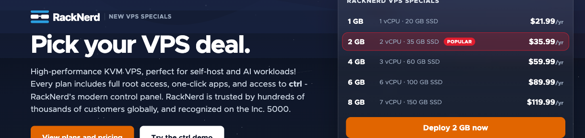
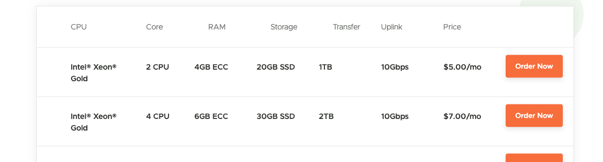
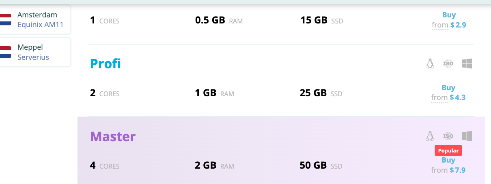
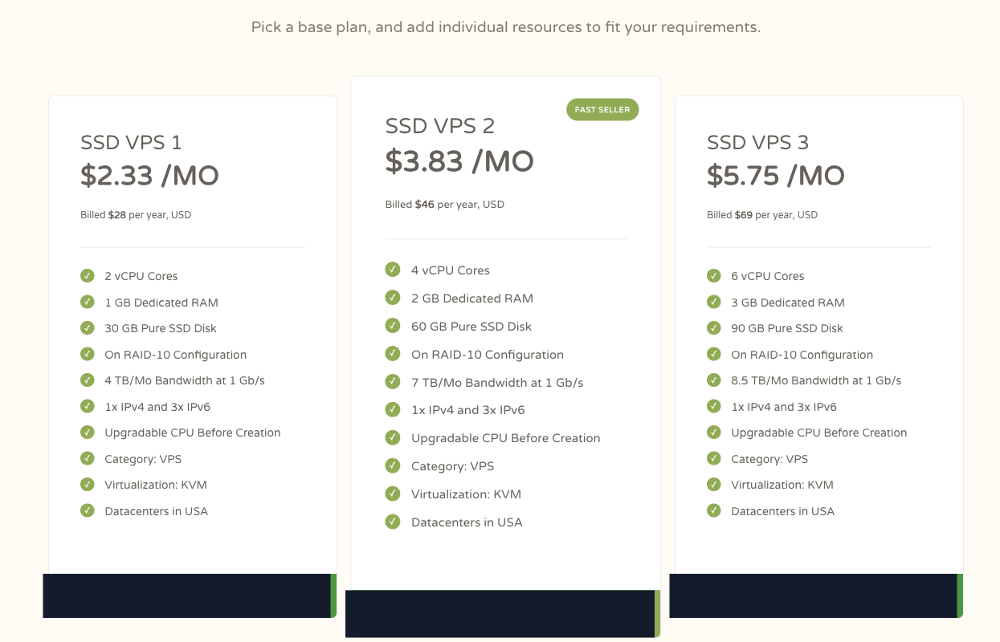
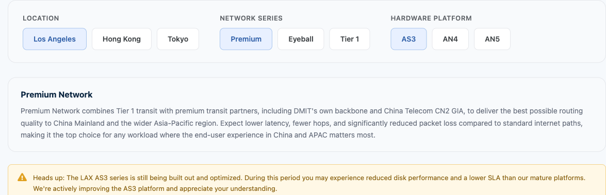

# 搬瓦工、DMIT 替代怎么选？四条低预算 VPS 路径对比

> **文章整理：2026-11-09｜公开页面快照：2026-11-02**  
> 本文比较公开套餐，不是同环境性能实测。价格、库存、税费、续费与政策都可能变化，付款前请在目标 SKU 的结账页复核。

> **推广披露：**本文含 RackNerd、VPSDime、ProfitServer、CloudCone 的本站推广链接；通过这些链接注册或购买，本站可能获得佣金。GreenCloudVPS、搬瓦工和 DMIT 使用普通官网链接。

## 先给答案：四种任务，对应四条购买路径

搬瓦工和 DMIT 有明确搜索心智，但它们不是所有海外 VPS 任务的默认答案。若你要练 Linux、运行轻量服务或部署海外任务，先比较下面四条路径；它们替代的是**付款方式、资源组合或部署地区**，不是已经验证的同线路产品。

| 你的任务 | 先看谁 | 为什么 | 关键边界 |
|---|---|---|---|
| 预计保留一年、可重建的常驻小任务 | **RackNerd** | 1 GB KVM 活动示例为 **$21.99/年**，全年账单低 | 一次付清全年；不等于月订阅，也不证明中国优化线路 |
| 需要较多内存、希望按月开始的 Linux 实验项目 | **VPSDime** | Linux 线 4 GB **$5/月**、6 GB **$7/月** | 低价 Linux 线不等于 Premium KVM；先核对虚拟化与软件兼容性 |
| 确实需要某个海外地区的独立节点 | **ProfitServer** | 公开页可按地点查看配置与展示价格 | 本文未确认目标地区的结账周期；先核对套餐、周期、总额与政策 |
| 明确要一台美国通用小机，愿意先付一年 | **CloudCone** | SSD VPS 1 快照为 **$28/年**，规格与年度总额都写在同一张卡上 | 页面同时显示 `$2.33/MO`，但实际标注为 `Billed $28 per year`；不是月付 |

以上金额或展示数字均来自 **2026-11-02** 的公开页面快照，不代表实时库存、锁价或续费承诺。

- [查看 RackNerd 年付活动与续费条件](https://my.racknerd.com/aff.php?aff=21833)
- [比较 VPSDime Linux 套餐](https://vpsdime.com/a/4857/linux-vps)
- [核对 ProfitServer 地区、套餐与付款周期](https://profitserver.net/?partner_id=3430198)
- [进入 CloudCone 推广入口，核对 SSD VPS 年付方案](https://app.cloudcone.com/?ref=14824)

**中国大陆或亚太访问路径是硬条件？** 不要按品牌名或最低数字下单，直接看后文的[线路例外](#线路是硬条件时搬瓦工和-dmit-才回到前排)。

## 同口径决策表：不要把不同账期的最小数字直接排名

| 角色 | 商家 | 2026-11-02 公开快照 | 支付／产品口径 | 更适合 | 付款前必须确认 |
|---|---|---|---|---|---|
| 主路径 | **RackNerd** | 1 GB KVM Specials **$21.99/年** | 年付，先付完整周期 | 可重建、预计常驻的轻负载任务 | 当前库存、续费、机房、备份、退款及目标网络 |
| 主路径 | **VPSDime** | Linux 4 GB **$5/月**；6 GB **$7/月** | Linux 产品线按月展示；与 Premium KVM 分开 | 内存需求明确、按月开始的实验或非关键任务 | 虚拟化／内核能力、软件兼容、CPU 与存储政策、备份 |
| 主路径 | **ProfitServer** | Amsterdam 卡片展示 `from $2.9`，其他配置展示不同数字 | 页面展示数字；本文未确认目标地区结账周期 | 地区明确、可独立恢复的海外节点 | 币种、周期、首期总额、续费、税费、端口、AUP 与退款 |
| 主路径 | **CloudCone** | SSD VPS 1 **$28/年**；卡片另示 `$2.33/MO` | 年付，先付完整年度；月数字是页面换算展示，不是月付 | 美国通用小机、个人站点、开发环境或轻量任务 | 实时库存、续费、退款、备份、目标机房与中国方向网络 |
| 补充候选 | **GreenCloudVPS** | 本文不采用一个未复核的统一成交价 | 库存与活动 SKU 驱动 | 会逐项核对地区、CPU、存储和销售条款的人 | 实时价格、库存、续费、退款资格、备份与具体线路 |
| 线路例外 | **搬瓦工／DMIT** | 不用不同系列的最低价作等价对照 | 必须落到机房、系列和具体 SKU | 中国方向路径直接影响业务结果的任务 | SKU 级线路说明、实测、库存、迁移规则与预算 |

这张表不是速度榜。本站没有在同一网络、同一时间、同一配置下测试这些商家，也没有验证中国电信、联通、移动晚高峰表现。

## 1. RackNerd：低全年持有成本，不是最低首次付款

RackNerd 的购买理由很具体：如果服务预计保留一年、可以随时重建，而且 1 GB 内存足够，**$21.99/年的完整年度账单**容易控制。适合练习 SSH、运行小型监控、轻量脚本、低流量个人服务或备用节点。

它不适合被包装成“最低首付款”方案。年付要先支付整年；相比之下，按月产品可能用更少首付款开始。`$21.99 ÷ 12` 只能得到年费的月均值，不能把它写成可按月取消的订阅。

*图注：2026-11-02 RackNerd 官方页面快照，仅裁去无关区域；展示的是当时的年付 Specials 配置与价格。非实时库存、非续费承诺、非本站实测。*

**适合：**

- 预计运行一年，并接受一次付清全年；
- 任务轻量、可重建，1 GB 配置确实够用；
- 海外访问为主，或愿意自行验证所选机房网络。

**不适合：**

- 项目可能一两个月就结束，首付款比全年成本更重要；
- 复杂容器栈、数据库或高负载任务尚未做容量估算；
- 国内生产业务要求明确的 CN2、三网优化或网络 SLA。

**购买判断：**愿意承诺一年，换取低全年账单，再进入套餐页核对库存与续费；否则不要只因月均换算数字看起来小而购买。

[查看 RackNerd 当前年付活动](https://my.racknerd.com/aff.php?aff=21833)

## 2. VPSDime：先分清 Linux 低价线与 Premium KVM

VPSDime 的低价 Linux 表在 2026-11-02 展示 **4 GB $5/月**、**6 GB $7/月**。它的价值是：内存配置明确、可以按月开始，适合短期实验、自托管测试环境或内存需求高于 1 GB 的非关键任务。

*图注：2026-11-02 VPSDime 官方 Linux VPS 页面快照，仅裁去无关区域；展示的是低价 Linux 产品线前两档公开规格。非实时库存、非续费承诺、非本站实测。*

但“Linux VPS”与“Premium VPS”在官网就是分开的产品入口，不能把前者的 `$5/月` 当成 Premium KVM 的价格，也不能因内存更多就推导数据库性能、独占 CPU 或稳定 I/O。

*图注：2026-11-02 VPSDime 官方首页快照，仅裁去无关区域；用于说明 Linux、Premium 等产品线是分开的购买入口。非实时库存、非续费承诺、非本站实测。*

**适合：**

- 需要 4 GB 或更多内存、希望按月开始；
- 软件在目标 Linux 产品的虚拟化与内核边界内可正常运行；
- 可以接受共享资源的不确定性，并能自行备份和恢复。

**不适合：**

- 把低价 Linux 线直接当成 Premium KVM；
- 需要嵌套虚拟化、特定内核模块或其他底层能力，却未先确认支持；
- 仅凭 RAM 数字推断持续 CPU、磁盘延迟或数据库可靠性。

**购买前先做一件事：**把要部署的软件、所需内核能力、虚拟化要求发给售前确认；若必须是传统 KVM 边界，就应比较明确标为 Premium KVM 的具体产品，而不是购买低价 Linux 线后再猜。

[查看 VPSDime Linux VPS 当前配置](https://vpsdime.com/a/4857/linux-vps)

## 3. ProfitServer：地区匹配优先，展示价不等于已知账期

ProfitServer 更合理的使用场景，是你已经知道需要 Amsterdam、Meppel 或其他公开地点的独立节点，并愿意按地点继续核对网络和订单。公开页面同时展示地点、资源和 `from` 数字，但这张页面本身**不足以确认你的目标地区按月结算**，也不能证明可以短周期自由增减。

*图注：2026-11-02 ProfitServer 官方页面快照，仅裁去无关区域；图中的 `from` 数字是页面展示价格，不代表本文已确认账期、税后总额或实时库存。非库存证明、非本站实测。*

**适合：**

- 业务确实需要页面列出的某个海外地区；
- 节点职责单一，故障后可从备份独立恢复；
- 愿意在结账前核对币种、周期、首期总额与政策。

**不适合：**

- 把 `from $2.9` 自动读成“每月 $2.9”；
- 只因节点地理位置更接近亚洲，就推断中国方向更快；
- 为了看似便宜而拆成多台，却没有计算多机总额、管理和备份负担。

**购买判断：**先选择目标地区，再确认确切套餐、付款周期、结账总额、续费、端口限制、取消与退款政策。任一项不匹配，就不要让首页展示数字替你做决定。

[核对 ProfitServer 当前地区、套餐与账期](https://profitserver.net/?partner_id=3430198)

## 4. CloudCone：$28 是年付总额，不是 $2.33 月付

CloudCone 的核心购买判断是**年度承诺与美国通用小机规格**。2026-11-02 官方 SSD VPS 页面中，SSD VPS 1 同时显示 `$2.33/MO` 与 `Billed $28 per year, USD`；应按**先付 $28 的年度产品**理解，不能把换算数字写成可逐月付款或随时停付。公开卡片还列出 2 vCPU、1 GB Dedicated RAM、30 GB Pure SSD、4 TB/月流量、KVM 与美国数据中心。它们是商家公开规格，不是本站性能测试。

*图注：2026-11-02 CloudCone 官方 SSD VPS 页面快照，仅裁去无关区域；SSD VPS 1 标注 `$2.33/MO`，同时明确 `Billed $28 per year, USD`，本文据此按年付总额解读。非实时库存、非续费承诺、非本站实测。*

CloudCone 的 **SSD VPS 与 SC2 是不同产品线**。SSD VPS 页面会引导读者切换到“come with more features”的 SC2；因此 SC2 的小时计费、自动备份、快照或面板功能，不能未经目标订单确认就写成 `$28/年` SSD VPS 已包含。

**适合：**

- 预计使用一年、接受一次支付完整年度；
- 需要美国通用小机，任务可重建，且公开资源足够；
- 愿意自行备份，并在下单前核对 SSD VPS 的产品级功能。

**不适合：**

- 只想按月试用，或把 `$2.33/MO` 当成月付入口；
- 需要中国优化线路、已验证晚高峰表现或最低价格保证；
- 因为 SC2 页面出现某项功能，就假定年付 SSD VPS 同样具备。

**购买判断：**若一年使用周期明确，先核对 SSD VPS 1 的实时库存、首期总额、目标机房、续费、退款及备份；任何一项不清楚，都不要只按换算月均价下单。

[进入 CloudCone 推广入口，核对 SSD VPS 年付方案](https://app.cloudcone.com/?ref=14824)

## 补充候选：GreenCloudVPS 适合会逐 SKU 挑库存的人

GreenCloudVPS 可以作为补充，而不是本文的并列主成交路径。它适合愿意按**具体库存**核对地区、CPU、内存、存储、流量和销售条款的用户；活动目录出现过某个配置，不代表此刻仍有货，也不能把一个 SKU 的网络说明外推到全品牌。

本文没有把未复核的活动价格写成统一成交价，也不声称它一定比四条主路径更省。如果四家主路径都不匹配，而你具备逐项核对能力，再查看 [GreenCloudVPS 普通官网目录](https://greencloudvps.com/)（非本站推广链接）。

## 线路是硬条件时，搬瓦工和 DMIT 才回到前排

预算型 VPS 能替代普通计算任务，不能无证据替代线路。只有以下条件同时成立，才应把搬瓦工或 DMIT 提到前面：

1. 主要用户确实在中国大陆或亚太，访问路径直接影响成交或业务可用性；
2. 你能写出目标地区、产品系列和具体 SKU，而不是只认品牌；
3. 你愿意用自己的运营商与真实时段测试，并承担对应预算。

DMIT 的公开页本身就要求按 `LOCATION`、`NETWORK SERIES` 与 `HARDWARE PLATFORM` 组合筛选；图中 Premium 说明也只适用于所选系列，不能推成 DMIT 全系结论。

*图注：2026-11-02 DMIT 官方定价页快照，仅裁去无关区域；用于说明线路判断必须落到地区、网络系列和硬件平台。页面文字是商家说明，非本站测速，亦非实时库存证明。*

搬瓦工同样应按当前机房、系列、库存与迁移规则核对，不能把历史限量套餐当作今天的默认成交选项。若线路是硬条件，可继续查看 [搬瓦工普通官网](https://bandwagonhost.com/) 与 [DMIT 普通官网](https://www.dmit.io/)；若只是练手、监控或海外轻任务，先回到前四条路径，避免为没有写清的线路需求付费。

## 付款前只核对这六项

1. **准确产品：**保存商家、产品线、SKU、机房与配置；品牌首页不能代替订单。
2. **总额与周期：**分清页面展示数字、首期结账总额、月付／年付、税费和续费。
3. **技术适配：**确认虚拟化、内核能力、CPU 政策、磁盘、流量、端口和 IPv4／IPv6。
4. **网络证据：**商家线路说明、Looking Glass 与自己的运营商实测分开记录。
5. **退出条件：**确认取消、退款、备份、快照、数据导出和停服后的保留时间。
6. **先小后大：**先买满足任务的最小规格；用真实任务验证后再扩容，不一次购买多年。

## 最后怎么选：按任务进入对应套餐

### 常驻轻任务，接受年付 → RackNerd

用低全年持有成本换取一台可重建的小机器；不要把年费月均值当月订阅。

[查看 RackNerd 年付活动与续费条件](https://my.racknerd.com/aff.php?aff=21833)

### 内存型 Linux 实验，希望按月开始 → VPSDime

先确认低价 Linux 产品线的虚拟化与软件兼容性；需要 KVM 时改看明确的 Premium 产品。

[比较 VPSDime Linux 套餐](https://vpsdime.com/a/4857/linux-vps)

### 明确海外地区的独立节点 → ProfitServer

入口是首页，不是预选订单；进入后先核对地点、套餐、付款周期、总额和政策。

[核对 ProfitServer 地区、套餐与付款周期](https://profitserver.net/?partner_id=3430198)

### 美国通用小机，接受先付一年 → CloudCone

把 `$28` 当年度首期总额，而不是把 `$2.33/MO` 当月付；下单前确认 SSD VPS 本身的功能，不把 SC2 能力外推过来。

[进入 CloudCone 推广入口，核对 SSD VPS 年付方案](https://app.cloudcone.com/?ref=14824)

## 资料边界与更新记录

- 文章整理日期：**2026-11-09**；金额和截图统一采用 **2026-11-02** 公开页面快照。
- 本站未为本文购买或实测上述产品；未做同环境速度、延迟、丢包、带宽、CPU 或磁盘排名。
- 未确认实时库存、地区税后价格、目标 SKU 续费、退款适用性，以及中国三网晚高峰表现。
- 不把 CN2、直连或中国优化状态外推到没有 SKU 级证据的产品；也不推断公开页面不可见的后台条款。
- **v0.5 · 2026-11-09** — 增加 CloudCone 为第四条主路径，明确 `$28/年` 与页面月均展示的边界，并将 SSD VPS 与 SC2 分开；GreenCloudVPS 仍为补充候选，搬瓦工与 DMIT 仍为线路例外。正文使用六张官方公开页面截图，支持购买判断，非本站购买或实测记录。
